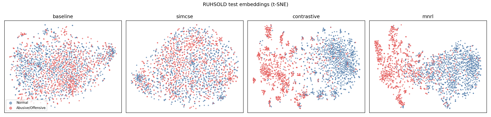

# Contrastive Representation Learning for Roman Urdu Hate Speech

An extension of my MPhil thesis (*Hate Speech Detection in Roman Urdu Text*, BERT + CNN-Gram on RUHSOLD).
The thesis fine-tuned `bert-base-multilingual-cased` with cross-entropy. This module asks a different question:
**can contrastive objectives shape the embedding space so that abusive and normal Roman Urdu text separate
more cleanly, and does that reduce missed hate speech (false negatives)?**

[](https://colab.research.google.com/github/quratulain77-saeed/Hate-Speech-detection-in-text/blob/main/contrastive/RUHSOLD_Contrastive_Learning.ipynb)

## Methods

All methods start from `bert-base-multilingual-cased` with mean pooling (via `sentence-transformers`).

| Name | Objective | Training signal |
|---|---|---|
| `baseline` | none (pre-trained mBERT embeddings) | — |
| `simcse` | Unsupervised SimCSE (Gao et al., 2021): MultipleNegativesRankingLoss on (x, x); dropout is the only augmentation | unlabelled text |
| `contrastive` | Margin-based contrastive loss (Hadsell et al., 2006), `OnlineContrastiveLoss`, margin 0.5 | same-class / cross-class pairs |
| `mnrl` | Supervised MultipleNegativesRankingLoss (InfoNCE-style) with an explicit cross-class **hard negative** | (anchor, same-class positive, other-class negative) |

For simcse and mnrl, batches use a no-duplicates sampler so the same sentence never appears twice in a batch as a false in-batch negative.

## Evaluation

Embeddings are frozen and evaluated on the RUHSOLD Task 1 test set (hate = positive class):

- **Linear probe** (logistic regression): macro-F1, MCC, ROC-AUC, FNR (missed hate speech), FPR (normal text flagged)
- **Cost-sensitive probe**: hate class weighted ×2 to penalise false negatives. This is the classifier-side analogue of a
  security-aware penalty, where missing a harmful item costs more than a false alarm.
- **kNN accuracy** (k = 10, cosine)
- **Silhouette** (cosine) between the two classes
- **Alignment and uniformity** (Wang & Isola, 2020): lower is better for both

## Results

RUHSOLD Task 1 test set (2,003 posts), frozen embeddings + logistic-regression probe, single run (seed 42), T4 GPU.

| Model | Macro-F1 | MCC | ROC-AUC | FNR | FPR | FNR (cost-sens.) | kNN acc | Silhouette | Alignment | Uniformity |
|---|---|---|---|---|---|---|---|---|---|---|
| baseline | 0.759 | 0.519 | 0.831 | 0.266 | 0.216 | 0.111 | 0.670 | 0.012 | 0.693 | -1.324 |
| simcse | 0.766 | 0.531 | 0.837 | 0.257 | 0.212 | 0.135 | 0.723 | 0.009 | 1.848 | -3.638 |
| contrastive | **0.886** | **0.772** | **0.951** | **0.113** | **0.115** | **0.094** | **0.889** | 0.478 | 0.341 | -0.927 |
| mnrl | 0.870 | 0.740 | 0.937 | 0.130 | 0.130 | 0.101 | 0.877 | **0.564** | 0.063 | -0.236 |

FNR (cost-sens.) = false-negative rate when the probe weights hate speech ×2; the corresponding FPRs are
0.479 (baseline), 0.424 (simcse), 0.144 (contrastive) and 0.192 (mnrl).



### Findings

- **Supervised contrastive training gives the large gain.** With the encoder frozen and only a linear probe on top,
  macro-F1 rises from 0.759 (pre-trained mBERT) to 0.886 with the margin-based contrastive loss and 0.870 with MNRL.
  Class separation (silhouette) rises from 0.01 to 0.48–0.56.
- **Unsupervised SimCSE barely helps (0.759 → 0.766).** Without labels, the objective improves general sentence
  geometry (kNN accuracy 0.67 → 0.72) but does not learn what makes a post abusive. Its training loss fell to ≈0 within
  the first epoch, suggesting the task was too easy for this short-text domain.
- **MNRL gives the tightest clusters (alignment 0.06, silhouette 0.56) but not the best probe score.** With only two
  classes, many in-batch "negatives" share the anchor's class, which is a known weakness of MNRL for binary labels;
  its training loss stayed near its starting value (≈4.1 → 3.9). A supervised-contrastive (SupCon) loss that masks
  same-class negatives is the natural next step.
- **Penalising missed hate speech is much cheaper on contrastive embeddings.** Weighting the hate class ×2 lowers FNR
  to 0.094 while FPR rises only to 0.144; on pre-trained mBERT the same penalty pushes FPR to 0.479.
- For reference, the fully fine-tuned BERT+CNN-Gram classifier from the thesis reaches macro-F1 0.90 on the same
  test set; a frozen contrastive encoder with a linear probe comes within ≈0.015 of it.

**Limitations:** one seed, 1–2 epochs, no hyperparameter search; results should be confirmed over several seeds.

## Reproduce

```bash
pip install -r requirements.txt
python src/evaluate.py --model bert-base-multilingual-cased --name baseline
python src/train.py --method simcse      --epochs 1 --batch_size 64 --out models/simcse
python src/train.py --method contrastive --epochs 2 --batch_size 32 --out models/contrastive
python src/train.py --method mnrl        --epochs 2 --batch_size 32 --out models/mnrl
for m in simcse contrastive mnrl; do python src/evaluate.py --model models/$m --name $m; done
python src/report.py
```

RUHSOLD is downloaded automatically from the [official repository](https://github.com/haroonshakeel/roman_urdu_hate_speech)
(Rizwan, Shakeel & Karim, EMNLP 2020). Seed = 42 throughout.

## Files

```
contrastive/
├── RUHSOLD_Contrastive_Learning.ipynb   # end-to-end Colab notebook
├── requirements.txt
└── src/
    ├── data.py       # loading + SimCSE pairs, supervised triplets, labelled pairs
    ├── train.py      # contrastive fine-tuning (simcse | contrastive | mnrl)
    ├── evaluate.py   # probes, kNN, silhouette, alignment/uniformity
    └── report.py     # results table + t-SNE figure
```

## References

- Gao, Yao & Chen (2021). SimCSE: Simple Contrastive Learning of Sentence Embeddings. EMNLP.
- Hadsell, Chopra & LeCun (2006). Dimensionality Reduction by Learning an Invariant Mapping. CVPR.
- Henderson et al. (2017). Efficient Natural Language Response Suggestion for Smart Reply. (MNRL)
- Wang & Isola (2020). Understanding Contrastive Representation Learning through Alignment and Uniformity on the Hypersphere. ICML.
- Rizwan, Shakeel & Karim (2020). Hate-Speech and Offensive Language Detection in Roman Urdu. EMNLP.
